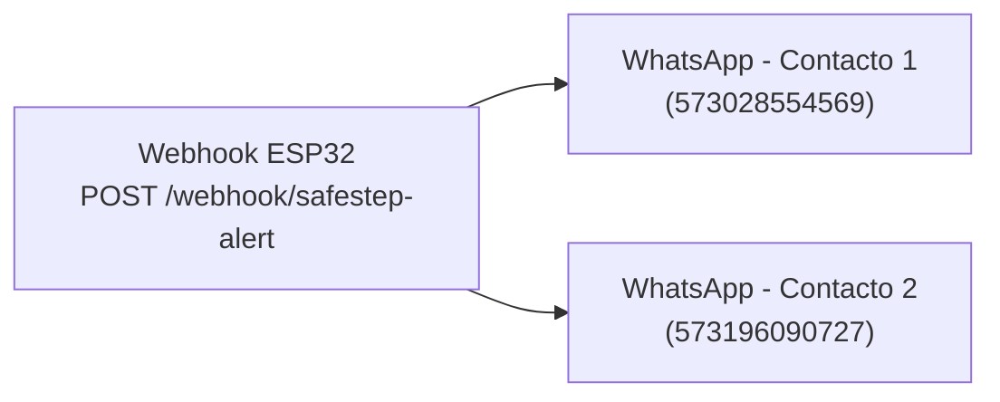

# DOCUMENTACIÓN TÉCNICA Y ARQUITECTURA DE SOFTWARE
## PROYECTO: SafeStep — Sistema Wearable de Detección de Caídas y Telemetría Médica

---

## 1. Resumen Ejecutivo y Justificación de la Migración

### 1.1. Estado Previo y Problemática Detectada
En la versión inicial del prototipo **SafeStep**, la notificación de emergencias médicas dependía de la **Meta Cloud API (WhatsApp Business)** oficial. Durante las fases de validación experimental en banco de pruebas se identificaron tres limitaciones críticas para un dispositivo de grado médico/hospitalario:

1. **Expiración de Tokens de Acceso:** Los tokens temporales emitidos por la plataforma de desarrolladores de Meta expiraban a las 24 horas, requiriendo intervención humana diaria para renovar variables de entorno en el firmware (`secrets.h`).
2. **Restricciones de Plantillas (Message Templates):** La API de Meta prohíbe el envío de mensajes libres sin aprobación previa de plantillas comerciales, limitando la personalización dinámica de variables clínicas críticas (e.g., cálculo vectorial de impacto en $\text{m/s}^2$, severidad, marcas de tiempo exactas).
3. **Colisiones de Criptografía TLS/mbedTLS en el ESP32:** El microcontrolador ejecutaba peticiones HTTPS concurrentes hacia Meta y Google Firebase Realtime Database. La memoria SRAM contigua del ESP32 (~80 KB libres) no soportaba dos sesiones TLS concurrentes, derivando en caídas de enlace (`start_ssl_client: -1`).

### 1.2. Solución Implementada: Soberanía Tecnológica y Open Source
Se diseñó e implementó una infraestructura desacoplada, autónoma y basada en microservicios contenerizados utilizando **Docker**:
* **Evolution API (Motor Baileys):** Conexión socket nativa directa al protocolo de WhatsApp mediante emulación Multi-Device, eliminando costos por mensaje y tokens expirables.
* **n8n Workflow Automation:** Middleware visual para la orquestación, transformación y distribución asíncrona de alertas médicas sin necesidad de re-flashear el dispositivo periférico.
* **Refactorización del Firmware ESP32 (FreeRTOS Dual-Core):** Aislamiento estricto de hilos de red, optimización del stack lwIP y enrutamiento dual para notificaciones médicas directas y telemetría continua.

---

## 2. Arquitectura Global del Sistema

El ecosistema SafeStep opera bajo una arquitectura distribuida de 3 niveles: **Dispositivo Físico (Edge)**, **Servidor de Gestión y Automatización (Fog/Cloud)** y **Receptores Finales (Personal Médico/Familiares)**.

```mermaid
graph TD
    subgraph EdgeDevice["1. Dispositivo Periférico (ESP32 DevKit V1)"]
        MPU["Sensor Inercial MPU6050 (I2C)"] -->|Muestreo 50 Hz| Core1["Core 1: Sensor Loop & WebServer"]
        Core1 -->|Cálculo Vectorial > Umbrales| AlertLogic{"¿Caída Detectada?"}
        AlertLogic -->|HTTP POST JSON (LAN)| NetEngine["Controlador de Enlace WiFiClient"]
        Core0["Core 0: firebaseTask (FreeRTOS)"] -->|HTTPS Insecure (2s)| FB[("Google Firebase RTDB")]
    end

    subgraph ServerStack["2. Servidor de Gestión y Despliegue (Docker)"]
        NetEngine -->|Puerto 8080| Evo["Evolution API (v2.3.0 - Baileys)"]
        NetEngine -->|Puerto 5678| N8N["n8n Workflow Engine"]
        Evo <-->|Persistencia| PG[("PostgreSQL 15")]
        N8N -->|Lógica Condicional| Evo
    end

    subgraph AlertDelivery["3. Dispositivos de Notificación"]
        Evo -->|Protocolo Signal E2EE| WA1["WhatsApp Médico de Turno"]
        Evo -->|Protocolo Signal E2EE| WA2["WhatsApp Enfermería / Familiar"]
    end
```

---

## 3. Estructura de Contenedores y Servicios (Stack Docker)

La infraestructura local del servidor se aloja en el directorio del proyecto `/safestep-server` bajo gestión de `docker-compose.yml`:

```
safestep-server/
├── docker-compose.yml          # Definición de servicios contenerizados y red aislada
├── safestep_workflow.json      # Flujo de trabajo exportable de n8n (distribución paralela)
└── volumes/
    ├── postgres_data/          # Persistencia de base de datos relacional
    ├── evolution_instances/    # Almacenamiento seguro de sesiones WhatsApp (Auth Keys)
    └── n8n_data/               # Configuración interna, workflows y logs de n8n
```

### Tabla de Microservicios Desplegados

| Servicio Contenedor | Imagen Base | Puerto Expuesto | Rol en la Arquitectura |
| :--- | :--- | :--- | :--- |
| **`safestep_postgres`** | `postgres:15-alpine` | `5432` (Interno) | Almacenamiento transaccional de metadatos de mensajería, estados de sesión y auditoría. |
| **`evolution_api`** | `evoapicloud/evolution-api:v2.3.0` | `8080:8080` | Pasarela WhatsApp autónoma basada en Baileys. Expone APIs REST seguras (`/message/sendText/{instance}`). |
| **`safestep_n8n`** | `n8nio/n8n:latest` | `5678:5678` | Motor de integración y webhooks para automatizaciones médicas, flujos paralelos y registro. |

### Configuración Clave de Resiliencia en `docker-compose.yml`
* **Desactivación de Redis:** En Evolution API v2.3.0, el uso de Redis local generaba reinicios en bucle de la conexión socket de WhatsApp (`[Redis] redis disconnected`). Se configuró persistencia directa en PostgreSQL (`DATABASE_ENABLED=true`, `DATABASE_PROVIDER=postgresql`) y caché local (`CACHE_LOCAL_ENABLED=true`), logrando estabilidad permanente de la sesión abierta (`state: "open"`).
* **Red Puente Dedicada (`safestep-net`):** Permite resolución por nombre de dominio interno (e.g., n8n consume `http://evolution-api:8080` sin salir a la interfaz de red física).

---

## 4. Ingeniería de Firmware (ESP32 — FreeRTOS y C++)

El firmware se diseñó en **C++** sobre el framework **Arduino-ESP32 (Espressif32 PlatformIO)**, dividiendo las cargas computacionales entre ambos núcleos del SoC Xtensa dual-core de 240 MHz.

### 4.1. Asignación de Tareas por Núcleo (Dual-Core Partitioning)

| Núcleo (Core) | Tarea / Proceso | Prioridad FreeRTOS | Función Operativa |
| :---: | :--- | :---: | :--- |
| **Core 1** | `loop()` Principal | Default (1) | * Muestreo inercial del MPU6050 a 50 Hz (intervalo fijo de 20 ms).<br>* Filtro de magnitud vectorial: $M = \sqrt{a_x^2 + a_y^2 + a_z^2}$.<br>* Máquina de estados de caída (`Estable`, `Leve`, `Fuerte`).<br>* Servidor web HTTP local embebido (puerto 80) para visualización clínica.<br>* Envío síncrono ultra-rápido de alertas por HTTP LAN (`sendWhatsAppAlert`). |
| **Core 0** | `firebaseTask()` | Prioridad 1 | * Sincronización continua de telemetría a Google Firebase RTDB cada 2000 ms.<br>* Recepción y despacho asíncrono de alertas encoladas mediante banderas volátiles (`pendingAlertSync`), eliminando bloqueos en el muestreo de aceleración. |

### 4.2. Resolución de Problemas de Red y Criptografía

#### A. Mitigación del Error `start_ssl_client: -1`
* **Causa raíz:** Las peticiones HTTPS hacia Firebase invocaban `WiFiClientSecure` sin certificados raíz ni modo no seguro explícito en el núcleo de Arduino. La rutina `ssl_client.cpp` abortaba la conexión al evaluar punteros de CA nulos (`line 65: return -1`), agotando los descriptores de socket de lwIP.
* **Solución aplicada:** Se forzó el uso explícito de instancias `WiFiClientSecure` en modo `setInsecure()` tanto para `/alerts.json` como para `/telemetry.json`:
  ```cpp
  WiFiClientSecure fbClient;
  fbClient.setInsecure();
  HTTPClient http;
  if (http.begin(fbClient, String(FIREBASE_URL) + "/telemetry.json")) {
    http.setTimeout(3000);
    http.PUT(makeDataJson());
    http.end();
  }
  ```

#### B. Eliminación de Latencia y Caída de Paquetes Wi-Fi
Por defecto, el stack de Espressif entra en modo *Wi-Fi Modem Sleep* para reducir consumo eléctrico, provocando que los tiempos de respuesta de ping superaran los 500 ms o perdieran paquetes SYN TCP. Se insertó en `setup()`:
```cpp
WiFi.mode(WIFI_STA);
WiFi.setSleep(false); // Garantiza conexión constante a nivel de radiofrecuencia
```

#### C. Mecanismo de Notificación Robusta y Redundancia
El método `sendWhatsAppAlert()` implementa un algoritmo secuencial multinúmero con reintentos y notificación paralela al webhook de n8n:
1. Envío directo secuencial mediante HTTP REST a Evolution API para cada contacto registrado en la lista:
   * **Contacto Primario:** `573028554569`
   * **Contacto Secundario:** `573196090727`
2. Notificación asíncrona hacia el Webhook de **n8n** (`http://192.168.5.134:5678/webhook/safestep-alert`) transmitiendo la carga útil clínica estandarizada:
   ```json
   {
     "paciente": "Belen Hortiz",
     "habitacion": "Habitación 305",
     "severidad": "Fuerte",
     "impacto": 22.54,
     "fecha_hora": "22/09/2026 00:20:37"
   }
   ```

---

## 5. Diseño del Flujo de Automatización en n8n

El flujo implementado en n8n se desacopla del hardware para permitir escalabilidad a múltiples destinatarios o canales adicionales (e.g., Telegram, Correo, Base de Datos Médica Hospitalaria) sin requerir modificaciones en el código C++ del dispositivo:



### Configuración del Payload Dinámico (Expresión n8n)
Para prevenir errores de serialización JSON (`The value in the "JSON Body" field is not valid JSON`), la interpolación de texto se gestiona de manera compatible con el motor de expresiones de n8n:

```javascript
={
  "number": "573196090727",
  "text": "🚨 *ALERTA MÉDICA SAFESTEP*\n\n" +
          "👤 *Paciente:* " + $json.body.paciente + "\n" +
          "📍 *Ubicación:* " + $json.body.habitacion + "\n" +
          "⚠️ *Severidad:* " + $json.body.severidad + "\n" +
          "💥 *Impacto:* " + $json.body.impacto + " m/s²\n" +
          "🕒 *Hora:* " + $json.body.fecha_hora + "\n\n" +
          "ℹ️ *Acción:* " + ($json.body.severidad === 'Fuerte' 
             ? 'Se confirma caída. ¡Se solicita atención médica inmediata!' 
             : 'Posible caída detectada. Se recomienda revisión preventiva.')
}
```

---

## 6. Fenomenología de Cifrado de Extremo a Extremo (E2EE - Protocolo Signal)

Durante las pruebas experimentales se documentó la visualización del aviso:  
`"Waiting for this message. This may take a while."` (*Esperando el mensaje. Esto puede tomar tiempo*) en la aplicación móvil de WhatsApp, a pesar de que el mensaje aparecía completamente legible en la versión WhatsApp Web.

### Explicación Científico-Técnica para el Trabajo de Grado:
1. **Mecanismo Multi-Device de WhatsApp:** Cuando una instancia de Baileys / Evolution API se vincula como dispositivo complementario (Companion Device), los mensajes salientes deben cifrarse independientemente con pares de claves Diffie-Hellman para cada dispositivo registrado tanto del remitente como del receptor.
2. **Rotación de Pre-Claves y Ratchet de Sesión:** Tras reiniciar contenedores o enviar ráfagas de pruebas consecutivas, el servidor genera un nuevo paquete de claves pre-compartidas (`outgoing prekey bundle`).
3. **Sincronización Asíncrona en el Dispositivo Móvil:** Si el teléfono principal se encuentra en suspensión o segundo plano, el sistema de notificaciones push de WhatsApp no descarga inmediatamente el paquete de llaves para descifrar el mensaje local en la base de datos SQLite del teléfono.
4. **Validación:** El descifrado se completa automáticamente cuando el teléfono sincroniza su sesión con los servidores centrales de WhatsApp o cuando se transmite un mensaje de respuesta dentro del mismo hilo conversacional.

---

## 7. Hoja de Ruta para Despliegue en Servidor en la Nube (Producción)

Para la puesta en producción permanente del sistema hospitalario fuera de la red de área local:

1. **Infraestructura de Servidor:** Máquina Virtual (VPS) con sistema operativo Ubuntu 22.04 LTS y 2 GB a 4 GB de RAM (e.g., Oracle Cloud Free Tier, Hetzner Cloud, AWS Lightsail).
2. **Proxy Inverso con Terminación TLS:** Despliegue de **Nginx Proxy Manager** o **Caddy** para emisión automática de certificados SSL gratuitos emitidos por Let's Encrypt (`HTTPS` con certificado válido para el subdominio `api.safestep.com`).
3. **Ajuste de Endpoints en el Firmware:** Modificación de `config.h` sustituyendo la IP privada de desarrollo (`192.168.5.134`) por el FQDN seguro del servidor:
   ```cpp
   #define EVOLUTION_API_URL "https://api.safestep.com/message/sendText/safestep"
   #define N8N_WEBHOOK_URL   "https://n8n.safestep.com/webhook/safestep-alert"
   ```
4. **Disponibilidad 24/7:** El dispositivo físico opera de forma autónoma a través de cualquier red Wi-Fi residencial o clínica, entregando telemetría y alertas sin requerir la presencia de una estación de trabajo local encendida.
